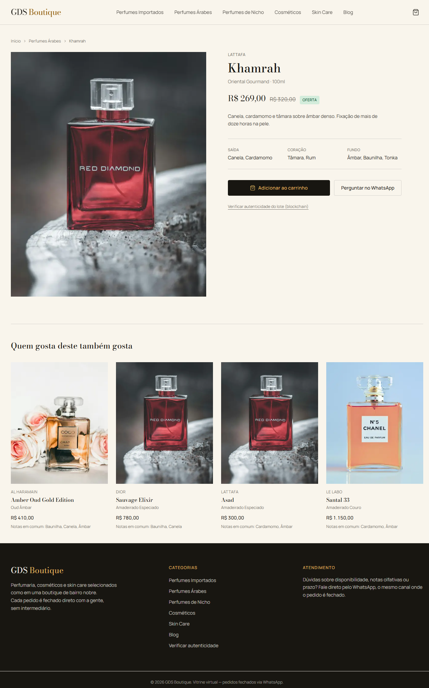
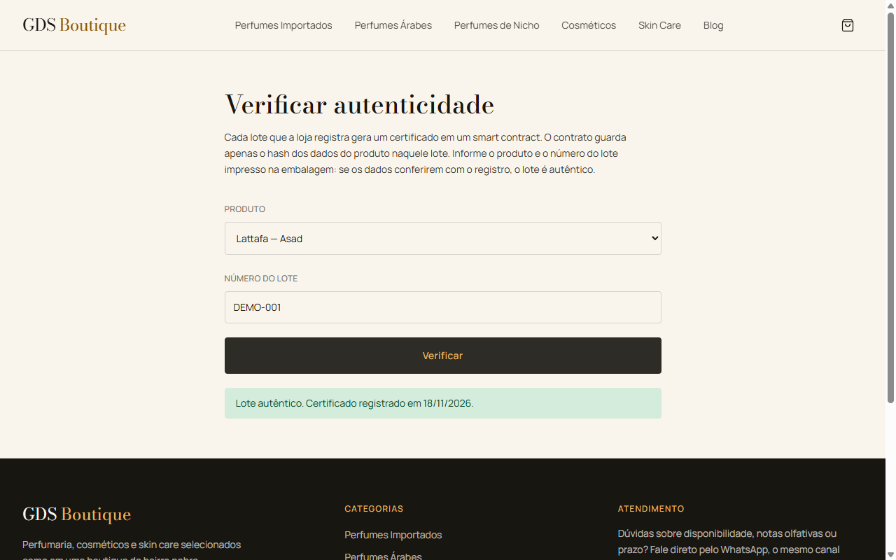
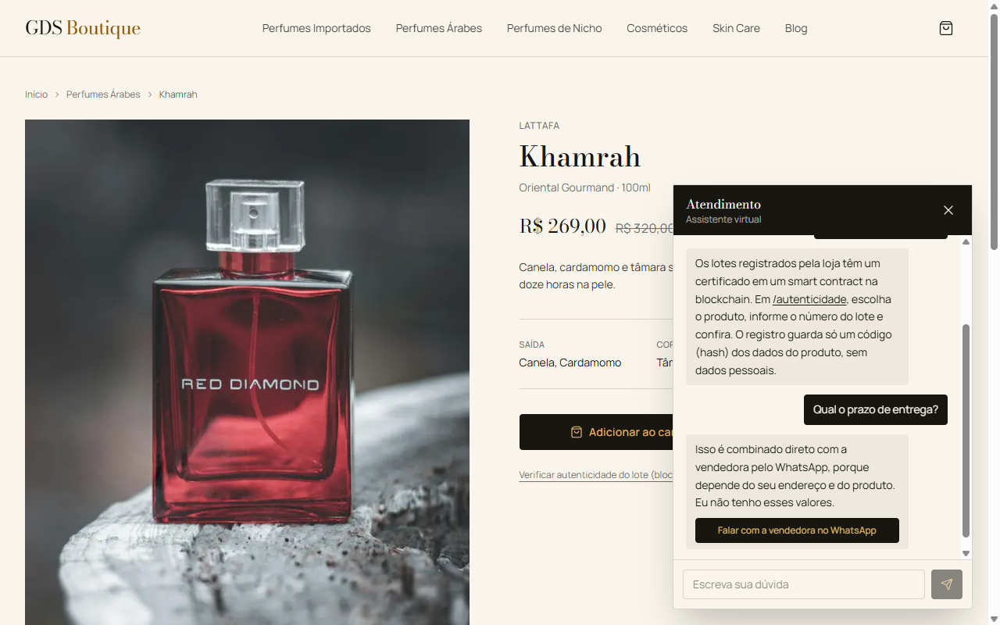

# Portfólio: Chatbots, IA, Blockchain e Docker

Trabalho final do curso, organizado como portfólio em três níveis de complexidade. Autor: Guilherme da Silva (GDS Frame).

O resultado é uma loja virtual de perfumaria (a **GDS Boutique**) que integra, em um único sistema que sobe com um comando:

- **frontend e backend em Docker** (Next.js, Flask, n8n e um nó blockchain local);
- **sistema de recomendação** por conteúdo (TF-IDF e similaridade de cosseno);
- **smart contract** em Solidity para certificar a autenticidade de cada lote;
- **chatbot** de suporte em n8n, com regras, FAQ e Gemini opcional, e os limites do que ele pode dizer garantidos em código;
- **blog** com SEO técnico e uma **campanha de marketing** documentada.



## Os três níveis

| Nível | O que mostra | Onde |
|---|---|---|
| 1 | Cada prática individual do curso, com código e o conceito que ela cobre | [nivel-1-praticas](nivel-1-praticas/README.md) |
| 2 | As tecnologias ajustadas à minha área (desenvolvimento web e marketing digital para pequenos negócios) | [nivel-2-area-de-atuacao](nivel-2-area-de-atuacao/README.md) |
| 3 | Todas as tecnologias integradas em um produto funcional | [nivel-3-produto](nivel-3-produto/README.md) |

## Experimente em 2 minutos

Requisito: Docker com Compose.

```bash
cd nivel-3-produto
ADMIN_TOKEN=escolha-um-valor docker compose up --build
```

Abra http://localhost:3000. Para ver a blockchain funcionando, siga a seção "Testando a blockchain" do [README do Nível 3](nivel-3-produto/README.md#testando-a-blockchain).





## Tecnologias

| Camada | Tecnologia |
|---|---|
| Frontend | Next.js 16, React 19, TypeScript, Tailwind CSS 4 |
| Backend | Python, Flask, scikit-learn, web3.py |
| Blockchain | Solidity 0.8, Hardhat, rede local |
| Chatbot | n8n (workflow versionado), Google Gemini (opcional) |
| Infraestrutura | Docker, Docker Compose |
| SEO | Metadata API do Next, JSON-LD, sitemap, robots |

## O que foi verificado

| Item | Resultado |
|---|---|
| Testes do contrato (Hardhat) | 8 passando |
| Testes do backend (pytest) | 16 passando |
| Testes do workflow do chatbot (`node --test`) | 25 passando |
| Frontend: lint, tipos e build | passando |
| `docker compose up` com os 5 serviços | sobe; API, recomendação e ciclo completo do certificado conferidos com `curl` |
| Chatbot no n8n real (2.35.5) | workflow importado e ativado; regras, FAQ e guardrails respondem pelo backend e pelo widget, no desktop e no mobile |
| Chatbot com o modelo | testado contra um servidor Gemini **simulado** (cota, resposta com dinheiro e slug inventado tratados) |
| Páginas do site (home, catálogo, produto, blog, autenticidade, sitemap, robots) | respondem 200 |
| Subida repetida e reinício do nó blockchain | os certificados são preservados na subida repetida, e o contrato é republicado se o nó reiniciar |

## Limitações conhecidas

- O chatbot com o **Gemini real** não foi testado, por falta de chave de API. Sem chave ele responde só por regras e FAQ.
- O enunciado sugere o Botpress. Aqui o chatbot é um workflow n8n próprio, pelos motivos em [chatbot/README.md](nivel-3-produto/chatbot/README.md).
- As fotos dos produtos vêm de um banco de imagens e não correspondem aos frascos reais.
- A campanha de marketing é um plano e não foi veiculada, então não há métricas.
- A blockchain roda em rede local, sem testnet pública.
- A prática de BI em Python tem só os conjuntos de dados, sem a análise.
- O exercício em Java não foi executado ao montar este repositório (não havia JDK na máquina).

## Estrutura

```
nivel-1-praticas/          exercícios de fundamentos
nivel-2-area-de-atuacao/   aplicação das tecnologias ao setor
nivel-3-produto/
  frontend/                Next.js (loja, recomendação, blog, widget de chat)
  backend/                 Flask (catálogo, recomendação, ponte com a blockchain e com o chatbot)
  contracts/               Solidity + Hardhat
  n8n/                     workflow do chatbot (nós de código, build e testes)
  chatbot/                 base de conhecimento (FAQ), fluxo e documentação do chatbot
  marketing/               campanha e estratégia de SEO
  docker-compose.yml
docs/img/                  capturas de tela
```
