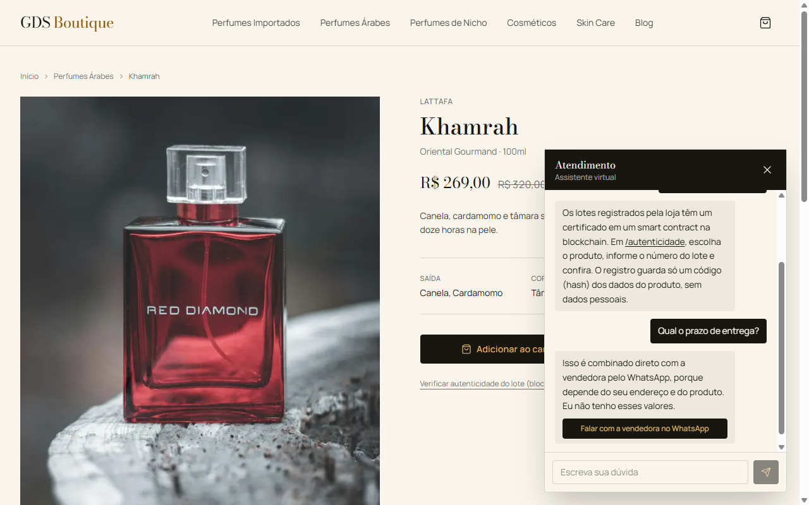
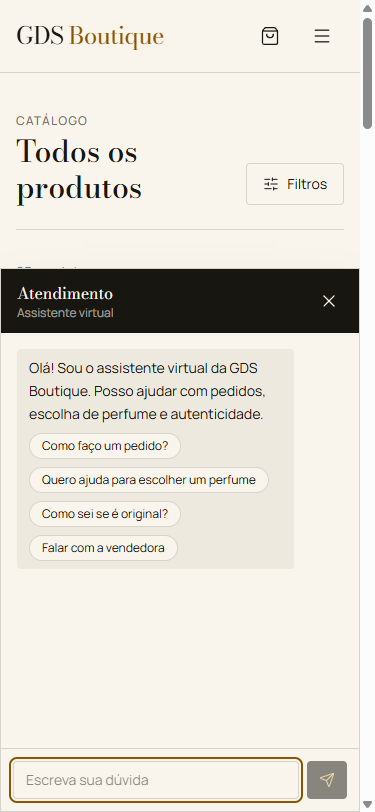

# Chatbot de atendimento (n8n)

Assistente virtual da GDS Boutique. Responde dúvidas frequentes (como pedir, escolher perfume, autenticidade, cuidados), recomenda produtos do catálogo e encaminha para a vendedora no WhatsApp quando a conversa precisa de uma pessoa.





## Por que n8n e não Botpress

O enunciado da atividade sugere o Botpress. Aqui o chatbot é um workflow **n8n self-hosted**, de autoria própria, porque:

- roda no mesmo `docker compose` do resto do produto, sem conta nem plano de um SaaS;
- as regras de negócio (o que o bot nunca pode dizer) ficam **em código versionado e testado**, não em configuração de uma plataforma;
- o mesmo padrão já é usado nos bots de automação da GDS Frame (n8n, guardrails em código, escalação para humano), então é uma solução que dá para operar e evoluir.

O resultado cobre o mesmo objetivo: um chatbot funcional que atende perguntas frequentes sobre o produto.

## Como funciona

```
navegador ──► Flask /api/chat ──► n8n (webhook) ──► resposta
                valida, limita        │
                e filtra              ├─ 1. regras em código ──► segurança, saúde, atendente, preço/prazo/pagamento
                                      ├─ 2. FAQ por similaridade ► responde sem modelo
                                      ├─ 3. Gemini (opcional) ──► recomenda produtos e responde o resto
                                      └─ 4. guardrails ─────────► barra o que o modelo não pode dizer
```

O workflow tem 9 nós. Cada decisão importante é um nó de código separado, com testes:

| Nó | O que faz |
|---|---|
| `normalizar` | Valida a mensagem (até 500 caracteres) e limita o histórico a 6 turnos. A chave do Gemini nunca entra nos dados do fluxo |
| `rota-direta` | Decide **sem modelo** o que for possível. Ver camadas abaixo |
| `catalogo` | Busca o catálogo na API (só no caminho do modelo) |
| `montar-prompt` | Monta o pedido ao Gemini com regras, FAQ e catálogo **sem preço** |
| `gemini` | Chamada HTTP com 2 tentativas e saída em JSON estruturado |
| `guardrails` | O código confere o que o modelo respondeu |
| `responder` | Devolve o JSON ao backend |

### As camadas, em ordem

1. **Regras em código.** Tentativa de extrair o prompt, assunto de saúde, pedido de atendente, desconto, prazo, frete, pagamento, troca e estoque nunca chegam ao modelo. Preço e prazo são da vendedora, e o bot diz isso em vez de inventar.
2. **FAQ por similaridade.** As perguntas do [faq.md](faq.md) são comparadas com a mensagem (palavras ponderadas pela raridade, com sinônimos). Se a semelhança for alta, a resposta sai direto, sem modelo e sem custo.
3. **Gemini.** Só entra se houver `GEMINI_API_KEY`. Recebe o FAQ e o catálogo e devolve JSON com a resposta e os produtos recomendados.
4. **Guardrails.** O prompt pede, o código garante: resposta com dinheiro, prazo, desconto, saúde, vocabulário proibido, repetida ou longa demais é trocada por um encaminhamento ao WhatsApp. Slug de produto que não existe no catálogo é descartado. Cota estourada, API fora e JSON inválido viram um encaminhamento, com o motivo no log do n8n.

Sem `GEMINI_API_KEY` o chat continua funcionando: responde pelas regras e pelo FAQ e, no que não souber, encaminha para a vendedora.

## Configuração

Variáveis lidas pelo serviço `n8n` do `docker-compose.yml` (todas opcionais):

| Variável | Para que serve | Padrão |
|---|---|---|
| `GEMINI_API_KEY` | Habilita o modelo. Pegue em [Google AI Studio](https://aistudio.google.com) | vazio (só regras e FAQ) |
| `GEMINI_MODEL` | Modelo usado | `gemini-2.5-flash` |
| `GEMINI_BASE_URL` | Endpoint do Gemini (útil para testes) | `https://generativelanguage.googleapis.com` |

Para usar o modelo, crie um `.env` ao lado do `docker-compose.yml` com `GEMINI_API_KEY=...` e suba de novo com `docker compose up -d`. O arquivo `.env` não vai para o git.

## Experimente

Com o stack no ar (`docker compose up`), abra http://localhost:3000 e clique no botão de chat no canto inferior direito. Ou direto pela API:

```bash
curl -X POST http://localhost:5050/api/chat -H "Content-Type: application/json" \
  -d '{"message":"Como faço um pedido?","history":[]}'
```

O editor do n8n fica em http://localhost:5678 (só na sua máquina). No primeiro acesso ele pede para criar um usuário local, e o workflow **Loja: chat de atendimento** já está importado e ativo.

## Testes

```bash
cd n8n && npm test
```

25 testes rodam os nós de código fora do n8n, incluindo os 10 casos de [fluxo.md](fluxo.md), os guardrails e a checagem de que o `chat-loja.json` commitado é exatamente o que o build gera.

## Estado

| Item | Situação |
|---|---|
| Regras, FAQ e guardrails | Testados em unidade e no n8n real (container `2.35.5`, a mesma versão de produção da GDS Frame) |
| Caminho do modelo | Testado de ponta a ponta contra um **servidor Gemini simulado**: chave no cabeçalho, catálogo sem preço no prompt, slug inventado descartado, resposta com dinheiro barrada, cota estourada tratada |
| Gemini real | **Não testado**, porque não havia chave. O formato da chamada segue a API `generateContent` |
